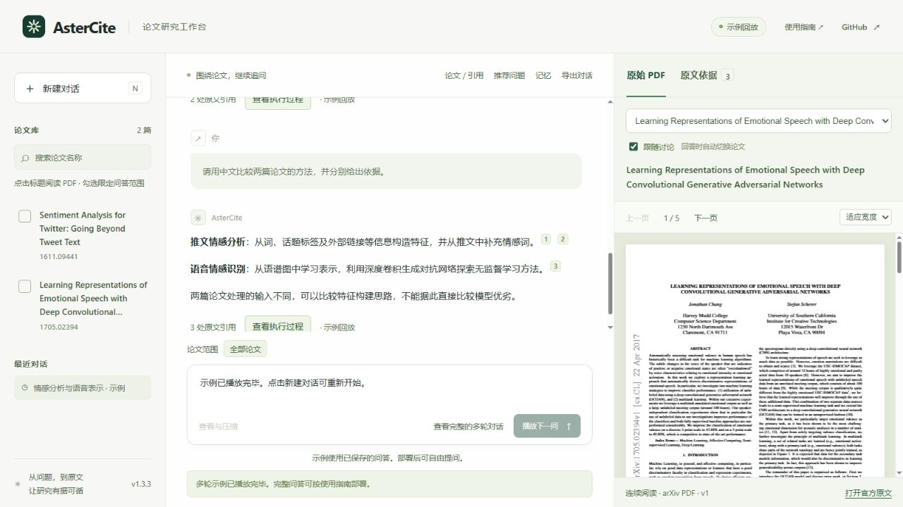
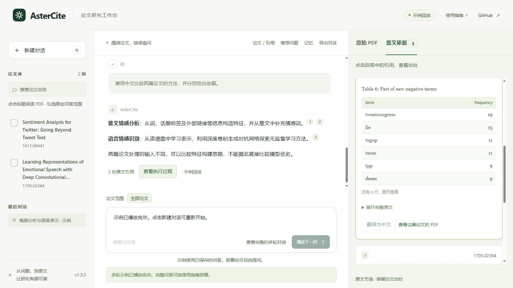
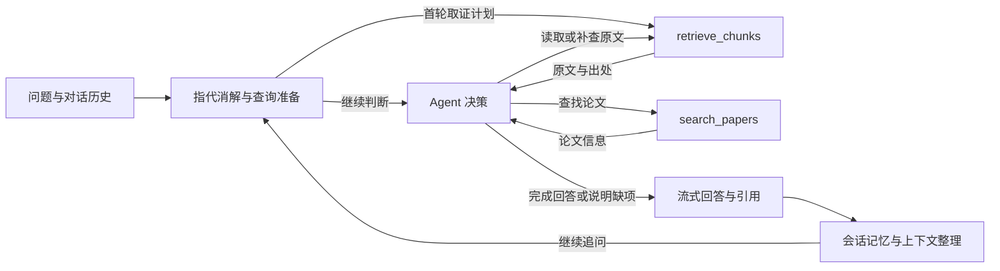

# AsterCite

[](https://github.com/Wahuwahuuu/AsterCite/actions/workflows/ci.yml)
[MIT License](LICENSE) · [下载 Windows 版](https://github.com/Wahuwahuuu/AsterCite/releases/latest) · [在线演示](https://astercite.niftyquail4.chatgpt.site)

AsterCite 是基于 Pi SDK 的科研论文问答工作台。选择论文、连续追问或比较不同文章，Agent 按需查找原文、补充检索，并在回答中给出可打开核对的引用。

支持 Windows 安装版、网页和 CLI。[在线演示](https://astercite.niftyquail4.chatgpt.site)播放公开问答示例；安装到自己的电脑或从源码启动后，可以配置模型自由提问。



*工作台公开示例：多轮问答、跨论文比较与原始 PDF 连续阅读。*

## 核心能力

- **混合检索**：BGE-M3 与 BM25 双路召回，RRF 融合，Cross-Encoder 重排。
- **多轮问答**：结合历史消解指代、整理检索查询，支持切换论文、纠正要求与跨论文比较。
- **证据引用**：回答附带论文、章节和原文片段，默认显示英文原文，点击按钮按需翻译为中文。
- **原文阅读**：全文滚动预览 PDF，悬停引用定位并高亮对应段落；读取可用的结构化原文，保留表格与公式。
- **执行回放**：按工具批次与时间轴查看 Agent Loop，打开每次模型请求的上下文、可见输出及工具参数和返回；压缩作为独立事件展示。
- **逐篇分析**：勾选多篇进行分析或比较，逐篇列出引用与证据不足之处。
- **任务控制**：实时查看逐项任务进度，随时停止生成，保留收到的回答并继续追问。
- **流式与排版**：逐步显示回答，支持 Markdown 标题、列表、表格、代码和数学公式。
- **会话管理**：重命名、置顶、归档、删除与恢复对话；查看实际会话记忆、上下文用量和压缩前后对比，默认在窗口占用达到 70% 时自动压缩。
- **长期记忆**：使用本地 Qdrant Edge 保存阅读进度、笔记和回答偏好，新对话按需找回，支持查看、编辑、删除与暂停。



*点击回答中的引用，查看对应英文原文、表格及论文出处。完整问答模式下可按需请求中文翻译。*

## 快速开始

下载 [Windows x64 安装包](https://github.com/Wahuwahuuu/AsterCite/releases/latest)，安装后从开始菜单打开 AsterCite。

1. 首次启动会准备本地检索模型，下载中断后可继续。
2. 填写自己的模型服务地址、模型名称和密钥。
3. 浏览器自动打开后，即可围绕内置论文自由提问。

安装包附带论文库、检索索引和运行环境。推荐 Windows 10 / 11 x64、16 GB 内存、10 GB 可用空间；首次使用需要下载约 4.6 GB 的检索模型。使用方法见 [Windows 安装指南](docs/windows.md)。

## 从源码运行

示例回放只需要 Node.js **24.11.1+**，无需模型密钥或 Python 检索环境：

```powershell
git clone https://github.com/Wahuwahuuu/AsterCite.git
cd AsterCite
npm ci --ignore-scripts
npm run web
```

打开 `http://127.0.0.1:4173` 查看多轮问答示例，点击引用阅读原文。终端回放可使用 `npm run demo`。

完整问答还需要 Python **3.12** 和本地检索环境。先按 [安装指南](docs/environment.md) 准备依赖、论文库、模型和索引，再配置模型：

```powershell
Copy-Item configs/model.example.json configs/model.local.json
```

填写服务地址与模型名称，在当前终端设置 `PIPAPER_API_KEY`，然后启动：

```powershell
npm run doctor
npm run web -- --live
```

网页会保存会话。更换模型或普通程序升级后，可继续已有网页对话。网页用法与服务器部署见 [网页指南](docs/web.md)。

模型服务需支持 OpenAI Chat Completions、流式响应与工具调用。配置字段和密钥设置方法见 [配置指南](docs/configuration.md)。

## CLI 使用示例

运行 `npm run paper -- --session research`，然后输入：

```text
/corpus Sentence-BERT
/scope 1908.10084
这篇论文如何得到句向量？请给出原文依据。
它与交叉编码器有什么区别？
接下来用中文回答，只比较推理过程。
/memory
/trace
/quit
```

再次使用同名 `--session` 可继续会话；一次性提问可加 `--ask "你的问题"`。

| 命令 | 用途 |
|---|---|
| `/corpus` | 查找论文 |
| `/scope` | 设置当前论文范围 |
| `/memory` | 查看会话记忆 |
| `/long-memory` | 查看长期记忆；支持 `pause`、`resume`、`forget ID` 和 `clear` |
| `/trace` | 查看阶段执行记录 |
| `/tasks` | 查看上轮逐项任务进度 |
| `/compact` | 压缩上下文 |
| `/budget` | 查看会话用量 |
| `/help`、`/quit` | 帮助与退出 |

## 架构



TypeScript 负责 Pi 会话编排、网页、CLI 和记忆管理；Python worker 负责本地检索与长期记忆存取。模型通过 `search_papers` 与 `retrieve_chunks` 获取论文证据，并根据返回结果决定继续查找或回答。

片段检索使用 BGE-M3 与 BM25 召回、RRF 融合和 Cross-Encoder 重排；表格与公式可补充读取论文的公开结构化原文。

## 文档

- [Windows 安装版](docs/windows.md)
- [安装与检索环境](docs/environment.md)
- [模型与会话配置](docs/configuration.md)
- [网页使用与部署](docs/web.md)
- [演示示例](demo/README.md)
- [贡献指南](CONTRIBUTING.md)
- [版本记录](CHANGELOG.md)

原创代码采用 [MIT](LICENSE) 许可，数据与依赖来源见 [第三方说明](THIRD_PARTY.md)。
